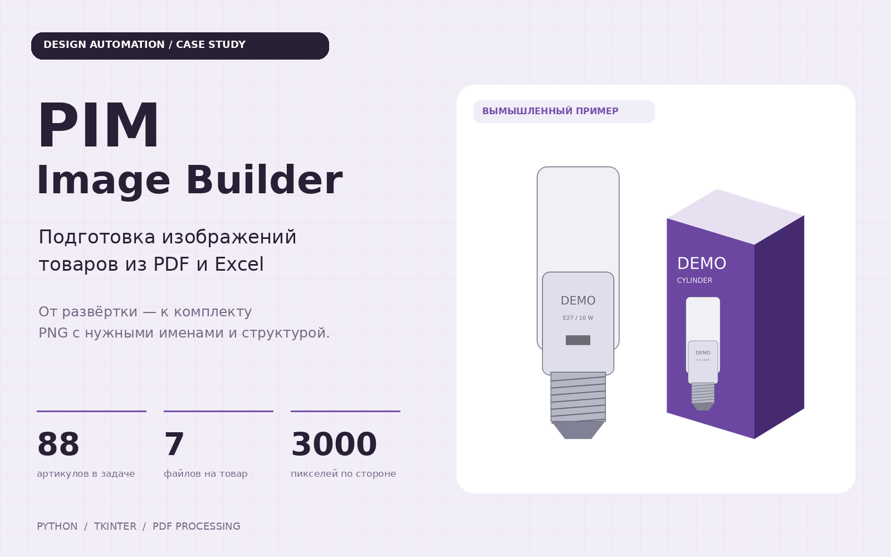
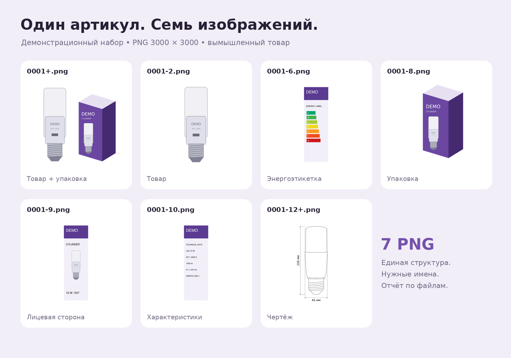
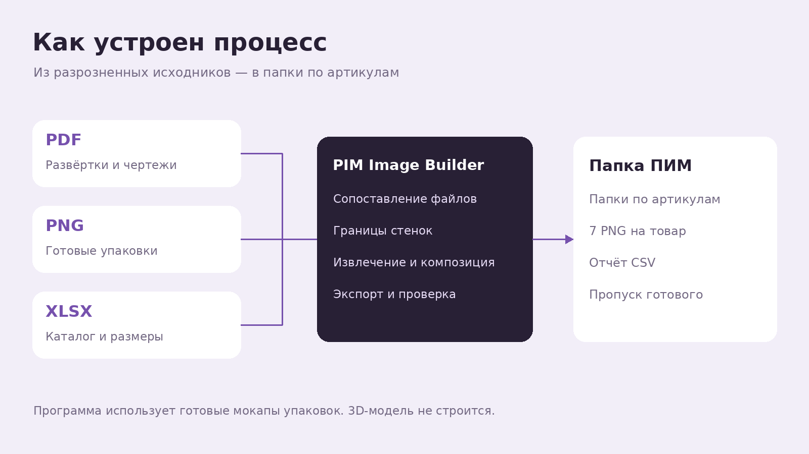

# PIM Image Builder

**Из PDF-развёрток — в готовые комплекты изображений товаров.**



Настольная программа для подготовки изображений к загрузке в PIM — систему управления информацией о продукции. Объединяет PDF-развёртки, готовые PNG упаковок, чертежи и каталог Excel в папки с семью изображениями на артикул.

Проект вырос из задачи графического дизайнера на **88 артикулов**. При семи изображениях на позицию это **616 выходных файлов**. В программу перенесены поиск исходников, вырезание сторон, сборка композиции, экспорт и именование.

> Это прикладной инструмент под определённую структуру таблицы и развёрток. Для других форматов исходников потребуется адаптация.

## Возможности

- ZIP-архивы или папки в качестве источников.
- Сопоставление файлов с артикулами по MatrixID или штрихкоду.
- Определение стенок развёртки по размерам коробки и слою Die-cut.
- Экспорт сторон без технических линий.
- Извлечение фотографии вместе с векторным логотипом.
- Композиция: товар слева, готовая упаковка справа.
- Замена размерных надписей в подходящем шаблоне чертежа.
- PNG 3000 × 3000, папки по артикулам и CSV-отчёт.
- Остановка после текущей позиции и пропуск полного комплекта при повторном запуске.



*Вымышленный товар и схематическая иллюстрация созданы для публичной демонстрации. Рабочие фотографии, каталог и макеты компании не включены.*

## Мой вклад

Я определила требования к изображениям, структуре папок и именованию. Подобрала исходники, описала нужные фрагменты PDF и проверяла результат с точки зрения дизайнера. В процессе уточняла работу с логотипом, прозрачностью, размерами и разными типами упаковок.

Код и технические исправления создавались с помощью ИИ. Моя роль — постановка задачи, проработка сценария и проверка визуального результата.

## Как устроен процесс



Программа читает лист NO и сопоставляет исходники. По размерам коробки и векторным линиям определяет стенки развёртки. Удаляет технический слой, извлекает товар, собирает композицию и обновляет размерные подписи. Затем сохраняет комплект и записывает статусы в отчёт.

## Семь файлов на артикул

| Имя | Содержание |
| --- | --- |
| `0001+.png` | Лампочка слева, упаковка справа |
| `0001-2.png` | Лампочка с логотипом |
| `0001-6.png` | Сторона с этикеткой энергоэффективности |
| `0001-8.png` | Точная копия готового PNG упаковки с новым именем |
| `0001-9.png` | Лицевая сторона развёртки |
| `0001-10.png` | Полная сторона технических характеристик |
| `0001-12+.png` | Чертёж с размерами лампочки |

Все изображения — 3000 × 3000 px. Чертёж сохраняется на белом фоне. Остальные изображения имеют прозрачные поля; белые области дизайна упаковки остаются. Фон готового PNG упаковки сохраняется как в источнике.

## Запуск в Windows

Нужен Python **3.10–3.13** с Python Launcher и Tcl/Tk. Photoshop не требуется.

1. Скачайте репозиторий через Code → Download ZIP и распакуйте целиком.
2. Дважды нажмите `START_PIM.bat`.
3. При первом запуске дождитесь установки библиотек через интернет.
4. В окне программы выберите источники, затем нажмите «Проверить исходники» и «Создать ПИМ».

Для знакомства используйте вымышленный набор из `demo/`:

| Поле | Что выбрать |
| --- | --- |
| PDF-развёртки | Кнопка «Папку» → `demo/pdfs` |
| Фото упаковки | Кнопка «Папку» → `demo/packs` |
| Чертежи | Кнопка «Папку» → `demo/drawings` |
| Таблица | `demo/catalog_demo.xlsx` |
| Другой чертёж цилиндра | Оставить пустым |
| Куда сохранить | Любая отдельная папка результата |

Получится `ПИМ/9990000000001_2027DEMO-0001/` с семью PNG. Повторите запуск, чтобы увидеть пропуск готового комплекта.

[Подробная инструкция и формат исходников](docs/USER_GUIDE.md)

## Технологии

**Python · Tkinter · PyMuPDF · Pillow · NumPy · pypdf**

| Файл | Назначение |
| --- | --- |
| `pim_app.py` | Окно, выбор источников, очередь событий, прогресс и журнал |
| `pim_engine.py` | Каталог, PDF, изображения, чертежи, экспорт и отчёт |
| `pim_geometry.py` | Поиск границ стенок развёртки |
| `assets/` | Шрифт, его лицензия и встроенный контур цилиндра |
| `demo/` | Вымышленные исходники для проверки |
| `tests/` | Интеграционный тест публичного сценария |

Обработка выполняется в фоновом потоке. Для пропуска готового комплекта используются SHA-256 подписи исходников, строки каталога и версии программы. Кандидаты геометрии оцениваются по поддержке векторных сегментов; неоднозначное положение стенок отмечается ошибкой.

## Проверка

В ходе разработки обработка проверялась на исходном наборе из 88 позиций; два цилиндра проверялись отдельно после добавления встроенного чертежа. Рабочие исходники в репозитории отсутствуют.

Публичный демонстрационный сценарий проверяет семь PNG, размер 3000 × 3000, целостность файлов, точное копирование упаковки, прозрачные поля и повторный запуск. Команда:

```bash
python -m pip install -r requirements.txt
python -m unittest discover -s tests -v
```

Проверки обработки выполняются в Linux с Python 3.12. Фактический запуск окна и BAT на Windows в среде разработки не проверялся. Экономия времени отдельно не измерялась.

## Ограничения

- Ожидается лист NO, определённые столбцы и MatrixID с префиксом `2027`.
- Поддерживаются одностраничные векторные PDF с распознаваемым слоем Die-cut. Сканы требуют другой обработки.
- Порядок стенок задан: техническая сторона, дополнительная сторона, лицевая сторона, энергоэтикетка.
- Поиск фотографии с логотипом основан на геометрии и векторных наложениях исходных макетов. Это не OCR и не универсальный поиск логотипа.
- Вырезание GX53 настроено на круглые корпуса на деревянном фоне из рабочего набора.
- Объём, блики, сгибы и европодвес берутся из готового PNG. Программа не строит 3D-мокап и не меняет европодвес по таблице.
- В чертежах меняются надписи размеров, а контур шаблона не перепроектируется.
- Встроенный цилиндр 41 × 125 мм — габаритная иллюстрация для карточки товара. Это не производственная документация.
- Для остальных типов нужны подходящие рабочие шаблоны. В публичном демо используется встроенный цилиндр.

## Публикация

Публичные примеры вымышленные. Сведения о сторонних компонентах находятся в [THIRD_PARTY_NOTICES.md](THIRD_PARTY_NOTICES.md). Лицензия на собственный код пока не выбрана; файл LICENSE не добавлен.
